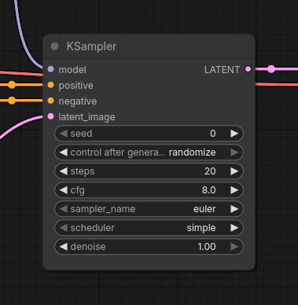

# ComfyUI-HighlightModifiedParameters

This extension highlights recently modified parameters by changing their outline. 

Values changed before running the workflow are highlighted with a white outline. On subsequent runs, if a value has not been modified, its outline shifts from orange to red, then back to the default grey, based on how many runs it has been since it was modified.

Tested on ComfyUI 0.43.0 ran locally, using Classic style nodes (canvas-based).
